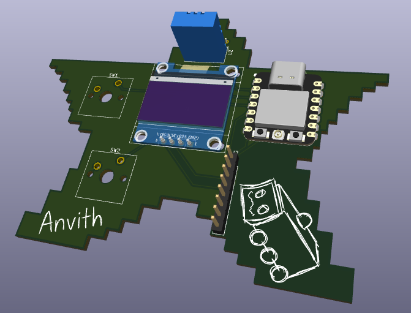
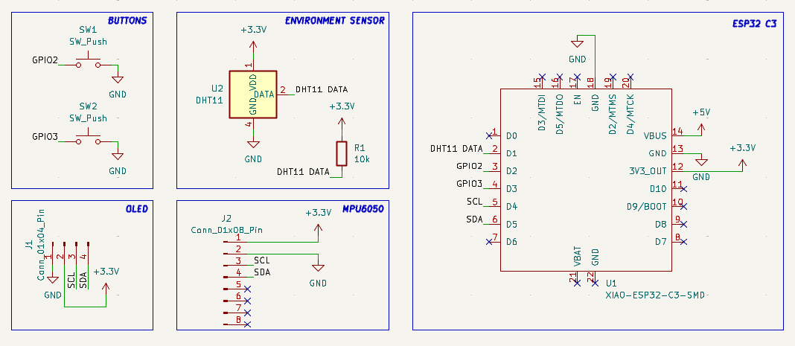
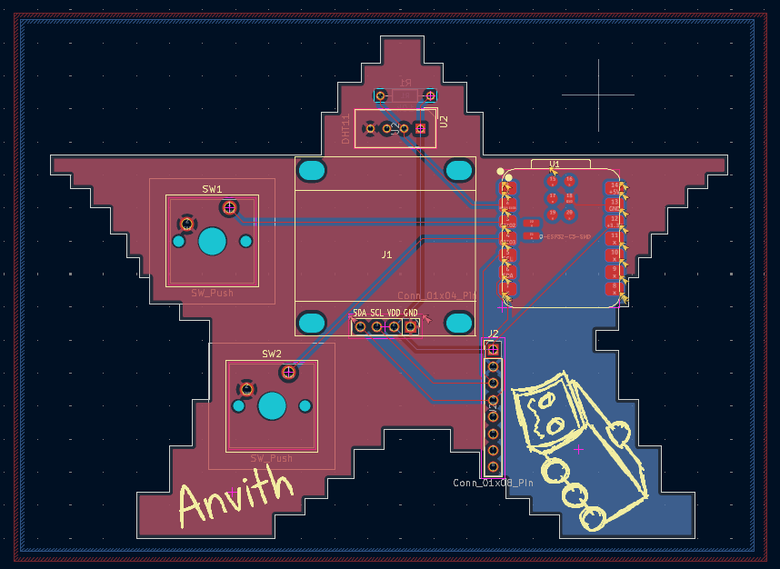

Starbie guide: https://github.com/SharKingStudios/Starbie/blob/main/Week%201%20Guide.md

I made the Starbie, and I followed the guide to create it. The guide was very helpful and provided step-by-step instructions on how to build the Starbie. I was able to complete the project successfully and learned a lot in the process. Additionally, to add my own personal touch, I replaced the shaking to do the animations with gestures instead. I did this by training a model to recognize specific gestures (I used my phone to collect the data, since I don't have the Starbie currently). I then used this model to trigger the animations based on the recognized gestures.

This was the final result:

This was my final schematic:

This was the final PCB design:

This is the accuracy of the model I trained to recognize gestures:

I made it because I wanted to learn how to use apps like KiCad, however I also wanted to go beyond the tutorial, and since I am stronger at code than hardware, I decided to make a software change, which was to replace the shaking with gestures.

I made it by following the guide (https://github.com/SharKingStudios/Starbie/blob/main/Week%201%20Guide.md) in KiCad. Then, for my addition, I collected motion data with my phone, trained the model in Edge Impulse, and added it to the firmware as a library.

**HOW TO ASSEMBLE AND FLASH THE FIRMWARE:**`

This is how you would flash the firmware to the Starbie:
1. Install the Arduino IDE
2. Add the ESP32 boards package, and pick “XIAO_ESP32C3” as the board.
3. List the libraries to install (Adafruit MPU6050, DHT sensor library, the OLED library, and your Edge Impulse model library)
4. Open Starbie.ino, plug in USB-C and upload.

To assemble it, you need a soldering iron, solder, flux, flush cutters, and optionally a multimeter. Then, you would solder from shortest to tallest:

1. XIAO ESP32-C3 (U1): surface-mount on the front, with the USB-C facing up. Put one pad and solder the rest, and check for bridges.
2. 10k resistor (R1): this will go on the back. Either direction works.
3. DHT11 (U2): on the front, with pin 1 (VCC) in the square pad.
4. MX switches (SW1, SW2): this willsnap in from the front, and then solder.
5. MPU6050 (J2): solder the header to the module first, then to the board, with VCC in the square pad.
6. OLED (J1): match the pins to the SDA/SCL/VDD/GND labels on the board.
7. Keycaps: press them on.

Before plugging in, make sure tocheck that 3.3V and GND aren't shorted. Then flash the firmware. If the screen turns on, it works.

**BOM:**

The final bill for the materials is in [BOM.csv](BOM.csv), and you can also see it below:

| Item | Qty | Supplier | Cost/item | Total cost | Link |
| --- | ---: | --- | ---: | ---: | --- |
| XIAO ESP32 C3 | 1 | AliExpress | $8.61 | $8.61 | [AliExpress](https://www.aliexpress.us/item/3256811424353248.html) |
| 0.96 OLED | 1 | AliExpress | $2.06 | $2.06 | [AliExpress](https://www.aliexpress.us/item/3256805941097111.html) |
| MPU6050 | 1 | AliExpress | $1.89 | $1.89 | [AliExpress](https://www.aliexpress.us/item/2251800504697800.html) |
| DHT11 | 1 | AliExpress | $1.54 | $1.54 | [AliExpress](https://www.aliexpress.us/item/3256807009759634.html) |
| MX Switches (10-pack) | 1 | AliExpress | $1.99 | $1.99 | [AliExpress](https://www.aliexpress.us/item/3256806171731329.html) |
| Keycaps (10-pack) | 1 | AliExpress | $2.47 | $2.47 | [AliExpress](https://www.aliexpress.us/item/3256807312571573.html) |
| 10k Resistor (100-pack) | 1 | AliExpress | $1.27 | $1.27 | [AliExpress](https://www.aliexpress.us/item/3256806338200607.html) |
| PCB | 1 | JLCPCB | $9.54 | $9.54 | [JLCPCB](https://www.jlcpcb.com/) |
| Estimated shipping | — | — | — | $1.61 | — |
| **Estimated total** |  |  |  | **$30.98** |  |
